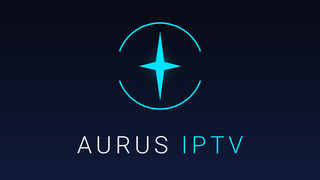

# Aurus IPTV for Android TV



> **Beta.** Aurus IPTV is still being tested, on few devices. Expect rough edges; faults are welcome under Issues.

A fast, ad-free player for your own IPTV playlist on Android TV and Google TV boxes. You give it a playlist link (M3U) from your provider; it shows the channels with logos and a programme guide, and plays them.

Aurus IPTV brings **no channels of its own**. It has no adverts, no account and no tracking, and your playlist link stays on the device. It is part of [Android TV Pack](https://github.com/android-tv-pack), next to the [Aurora launcher](https://github.com/android-tv-pack/aurora-launcher).

## Install

1. Download **Aurus-IPTV-beta.apk** from the newest entry on the [releases page](https://github.com/android-tv-pack/aurus-iptv/releases).
   Direct link, for the *Downloader* app on the TV: `https://github.com/android-tv-pack/aurus-iptv/releases/download/v0.22-beta/Aurus-IPTV-beta.apk` (the link names the version, so it changes with each beta)
2. Put it on the TV and open it: with a file manager app, with the *Downloader* app, or from a USB stick. Android asks once to allow installs from that app.
3. Open **Aurus IPTV**, press **MENU** (or choose *Settings* at the bottom of the channel lists), and add your playlist under *Playlists*.

To update, install the new APK over the old one: playlists, favourites and settings are kept, because every release is signed with the same key. (If you build and sign it yourself, remove the old copy first, as the signature differs.)

Typing a long link with a remote is slow. With a computer on the same network, `./send-playlist.sh <tv-address>` sends it over adb without showing or storing it.

## What it does

- **Several playlists**, each with its own favourites, recent channels and guide. Switch between them in the channel window.
- **Programme guide (EPG)**: the one your playlist names, or EPGs you add yourself (XMLTV, `.xml` or `.xml.gz`), chosen per playlist. An optional second list can supply logos.
- **Channel window**: groups, channels with logos and what is on now, and a small picture with the programme's description.
- **Catch-up**, where the playlist says a channel is recorded: earlier programmes, start over, pause and rewind.
- **Sound, subtitles and picture size** while watching, plus a sleep timer.
- **Refresh rate matching**: the TV is switched to the channel's rate (50, 60 or 24 Hz) once you stay on a channel, for even motion.
- **Recent channels on the TV's home screen**, so a launcher can show them.
- Streams: HLS (the well-tested path) and DASH; readers for Smooth Streaming, RTSP and plain files over HTTP are included.

## Keys

| Key | While watching |
|---|---|
| OK or Left | The channel window |
| Hold OK | Pause, start over, sound, subtitles, picture, lip sync, sleep timer |
| Up / Down | Next and previous channel |
| Right | Programmes of this channel (earlier days on recorded channels) |
| Digits | Go to a channel number |
| Back | The channel that was on before |
| MENU | Settings |

In the channel window: OK watches, hold OK marks a favourite, Back closes.

## Build

JDK 17 and the Android SDK (platform 36).

```sh
echo "sdk.dir=$HOME/Library/Android/sdk" > local.properties
./gradlew testReleaseUnitTest assembleRelease     # app/build/outputs/apk/release/app-release.apk (debug-signed)
```

The parts that do not depend on Android (playlist and guide parsing, lists, catch-up addresses, frame-rate rules) are plain Kotlin under `core/`, with unit tests.

## Limits

- Tested on one device, a Xiaomi TV Box S (3rd gen, Android 14, Amlogic), mostly with one provider's HLS playlist. Other boxes and providers may behave differently.
- No Xtream Codes or Stalker portal login: playlists are M3U links only.
- No recording to disk.
- Not yet tested: Smooth Streaming and RTSP channels, opening a channel from the home-screen row, DVB bitmap subtitles, channels with several sound tracks on a real provider, catch-up formats other than the "shift" kind, and the "Video hardware" playback mode.
- A screen-rate change makes the TV go dark for a moment; boxes without seamless switching cannot avoid that.

## Open-source parts

Playback uses [AndroidX Media3 / ExoPlayer](https://github.com/androidx/media) (Apache License 2.0).

## License

MIT, see [LICENSE](LICENSE).

## Support

If this project is useful to you, you can support its development:

[](https://ko-fi.com/G0U5290K4T)
